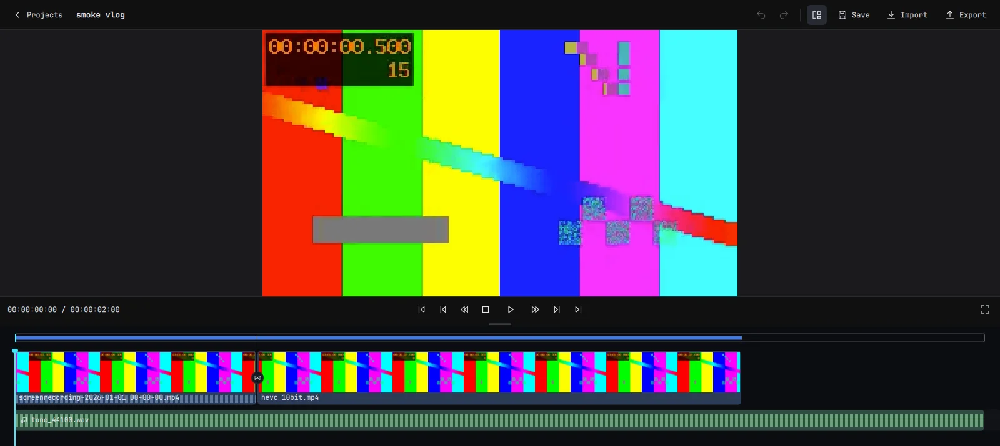

# OmaMovie


OmaMovie is a video editor for Omarchy and current Arch Linux. It is for people who want to assemble local video, audio and pictures into a movie, check the edit with sound, save their work and export a shareable file. The first public release candidate targets x86_64; [Intel Iris Xe and software rendering are the validated configurations](#release-candidate-scope).



*The editor running a synthetic test edit. The screenshot comes from the GUI smoke test.*

## Make your first edit

On Omarchy or a current Arch Linux system, clone this repository and run:

```sh
make deps
make run-gui
```

`make deps` installs the dependencies in [PKGBUILD](PKGBUILD) through `pacman` and may request sudo. `make run-gui` builds and opens the editor. To install a system package instead, run `makepkg -si` from the repository root.

The first-opening tour introduces the controls and opens a bundled, editable three-shot demo. You can use it to try an edit without finding media first:

1. Play the demo with Space. Select a clip and move the playhead to the cut you want to change.
2. Split with `Ctrl+B`, then undo with `Ctrl+Z` if needed. Open the Command Palette with `Ctrl+K` to find actions and their shortcuts.
3. Save your copy as a `.omamovie` project with `Ctrl+S`. Export a movie with `Ctrl+E`, then choose a profile supported by your installed FFmpeg build.

For your own footage, start a **New project** and choose **Import** (`Ctrl+I`). Files imported into an empty timeline are added to the storyline. Later imports remain in the media library until you select one and use **Add** (`E`). In the source viewer (`Shift+O`), mark In (`I`) and Out (`O`) before adding a shorter range. Escape returns to the sequence viewer. The original media stays on disk and is not modified.

## What you can do

- Arrange clips with append, insert, overwrite, trim, split, delete and ripple edits; undo and redo the changes.
- Preview the sequence with sound, and adjust clip gain, fades and mute.
- Add titles, looks and transitions, then export MP4, Matroska or WebM using the available profiles.
- Save and reopen `.omamovie` projects. If a source file has moved, the editor keeps its missing reference so you can locate it.
- Import documented subsets of OTIO, FCPXML, EDL and MLT projects. See the [interop matrix](docs/interop.md) before using another editor's project as the source of an edit.

## Install and release files

The [GitHub Releases page](https://github.com/KitsuneForgering/OmaMovie/releases) provides release candidates, source archives and checksums. The x86_64 Linux application archive contains the installed `usr/` tree; it uses system Qt, FFmpeg, Vulkan and other [package dependencies](PKGBUILD), so it is not a self-contained application. On current Arch/Omarchy, `makepkg -si` builds, tests and installs the package, launcher, icon and `.omamovie` file association.

The editor follows the active Omarchy theme and font. If Omarchy's window opacity makes the video viewer translucent, see the [Hyprland window rule](docs/omarchy-window-rule.md).

## Release candidate scope

This release candidate is intended for real edits and feedback. Intel Iris Xe and the software path have been validated; AMD, NVIDIA and hybrid GPU machines have not. The viewer uses Intel VA-API decoding when available and software decoding elsewhere. Set `OMA_PREVIEW_HARDWARE=0` to force software decoding. H.264 export can use the Intel GPU encoder, with a software fallback; other export profiles use software encoders. Export uses the project's frame size and rate.

Import checks that selected streams can decode an initial frame or samples, but damage later in a file may still cause a decode error. Cross-editor imports cover the subsets in the [interop matrix](docs/interop.md), rather than every project those editors can create. Export currently transfers rendered frames through host memory before encoding.

Please report unclear steps, incorrect output and crashes in [GitHub Issues](https://github.com/KitsuneForgering/OmaMovie/issues). Include your version, hardware, source format and steps to reproduce when possible.

## Development and documentation

Run `make test` for the library tests or `make help` for available targets. The [implementation plan](docs/implementation-plan.md), [UI design](docs/ui-design.md), [format boundaries](docs/format-architecture.md), [contribution guide](CONTRIBUTING.md) and [agent guide](CLAUDE.md) provide deeper detail.

License: [MIT](LICENSE).
